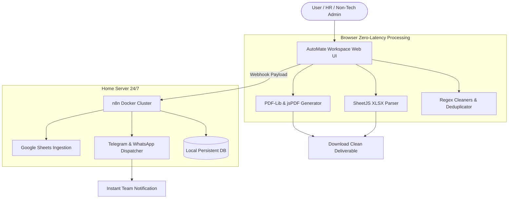

<div align="center">

# 🚀 AutoMate Workspace
### All-in-One Everyday Office Automation Suite powered by n8n Engine

[](https://toti-417.github.io/automate-workspace/)
[](./LICENSE)
[](https://react.dev/)
[](https://tailwindcss.com/)
[](https://n8n.io)
[](https://www.linkedin.com/in/toti-putra-pratama/)

<p align="center">
  <strong>Web-based productivity suite providing 10 production-ready automation modules for non-technical office workers, HR recruiters, finance teams, and telco operations.</strong>
</p>

[**Explore Live Demo**](https://toti-417.github.io/automate-workspace/) · [**Report Issue**](https://github.com/Toti-417/automate-workspace/issues) · [**Explore Portfolio**](https://portofolio-toti.vercel.app)

</div>

---

## 📖 Overview

**AutoMate Workspace** was engineered to solve repetitive administrative, operational, and data bottleneck problems faced daily by non-tech professionals. By combining client-side zero-latency processing (`pdf-lib`, `jspdf`, `xlsx`) with asynchronous webhook triggers connected to a **self-hosted 24/7 n8n Docker engine**, users can transform raw text, messy spreadsheets, and paper receipts into structured corporate deliverables in under 30 seconds.

---

## ⚡ 10 Integrated Production Modules

| Category | Module Name | Primary Capability | Key Technology |
| :--- | :--- | :--- | :--- |
| 📄 **Document & PDF** | **Smart Doc to PDF** | Converts raw text/Word drafts to formal ISO A4 PDF with background digital watermark and metadata. | `jsPDF`, Dynamic Canvas |
| 📄 **Document & PDF** | **Multi-PDF Merger** | Merges multiple PDF attachments, CVs, and receipts into a single bound document directly in-browser. | `pdf-lib` |
| 👥 **HR & Recruitment** | **TalentScan (CV Screener)** | Extracts WhatsApp (+62), Email, skills, and experience from resumes, calculates match scores (0–100%), and exports to Excel. | Regex Engine, `XLSX` |
| 👥 **HR & Recruitment** | **CertiSend (Auto Certificate)** | Generates dozens of verified landscape award certificates with official verification hashes simultaneously. | `jsPDF`, Vector Drawing |
| 💰 **Finance & Invoicing** | **BillToSheet (Invoice OCR)** | Scans vendor invoices, extracts hardware items, auto-calculates Indonesian PPN 11% tax, and exports to Excel & PDF. | `jspdf-autotable`, `XLSX` |
| 💰 **Finance & Invoicing** | **ExpensifyLite (Reimbursement)** | Tracks field technician petty cash, toll receipts, fuel claims with one-click verification and approval toggles. | Reactive State, `XLSX` |
| 📊 **Spreadsheet & Data** | **DataPolish (Sanitizer)** | Normalizes messy Indonesian phone numbers into E.164 (`+62`), strips trailing whitespace, deduplicates rows, and fixes casing. | Sanitization Pipeline |
| 📊 **Signature Telemetry** | **TelcoPulse (Regex Telemetry)** | Signature feature based on 4+ years Telkomsel operations: parses raw BTS alarm logs, VSWR, RSRP, and fiber cut incidents into analytics tables. | Regex MML Parser |
| ⚡ **Operations & Meeting** | **MeetSummary (MoM Rapat)** | Converts raw voice/text meeting transcripts into executive Minutes of Meeting (MoM) with assigned Action Items and PICs. | NLP Pattern Parser |
| ⚡ **Instant Alerts** | **NotifBot (Webhook Dispatcher)** | Transmits emergency operational alerts and new candidate triggers directly to Telegram, WhatsApp, and n8n webhooks. | Fetch API, n8n Webhook |

---

## 🏗️ Architecture & Data Flow



---

## 🚀 Quick Start Guide

### Prerequisites
- Node.js `v18.0.0` or higher
- npm `v9.0.0` or higher

### Installation
```bash
# 1. Clone repository
git clone https://github.com/Toti-417/automate-workspace.git
cd automate-workspace

# 2. Install dependencies
npm install

# 3. Start local development server
npm run dev
```
Open [http://localhost:5173](http://localhost:5173) in your browser.

### Production Build
```bash
npm run build
npm run preview
```

---

## 🔌 n8n Integration

Pre-built workflow blueprints ready for instant import (`Ctrl + V`) are included in `src/utils/n8nWorkflows.js`:
- `wf-cv-screener`: Inbound webhook parsing CV text, syncing to Google Sheets, and alerting Telegram HR.
- `wf-invoice-ocr`: Receipt tax calculation and automated financial ledger logging.
- `wf-telco-alert`: Telecom alarm storm filter with severity threshold dispatcher.

---

## 👨‍💻 Author & Acknowledgements

Created with pride by **Toti Putra Pratama**  
- **Role**: Data Analyst & Telecom Automation Specialist
- **Portfolio**: [https://portofolio-toti.vercel.app](https://portofolio-toti.vercel.app)
- **LinkedIn**: [linkedin.com/in/toti-putra-pratama](https://www.linkedin.com/in/toti-putra-pratama/)
- **Email**: `totiputra08@gmail.com`

---

## 📄 License

This project is licensed under the MIT License - see the [LICENSE](./LICENSE) file for details.
